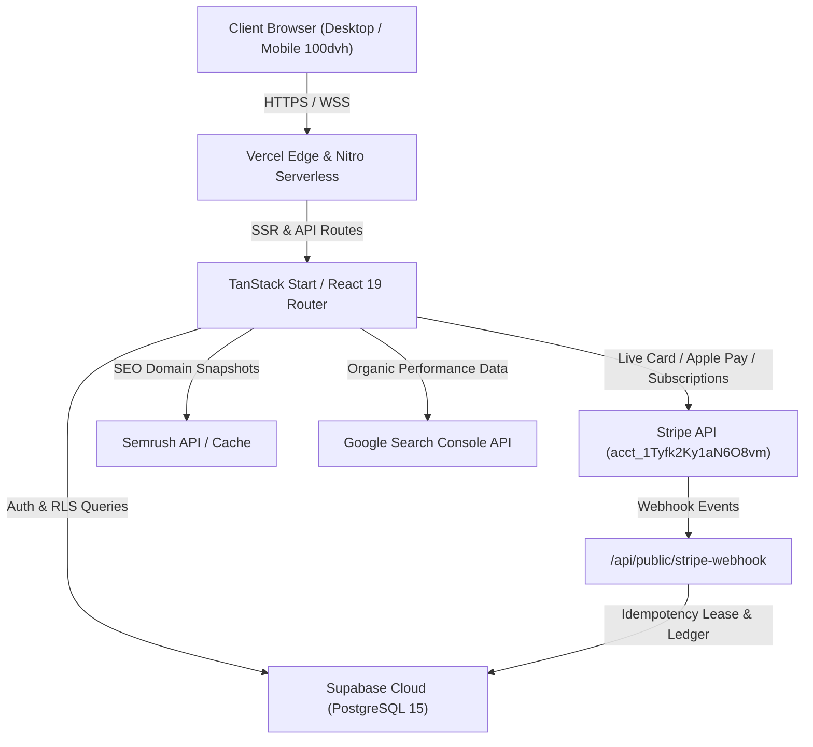
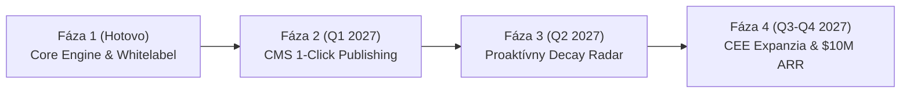

# 🛠️ SEO4WEB — Developers & DevOps Architectural Guide

> **Architektonická, technická a devops špecifikácia projektu SEO4WEB**  
> **Oficiálna produkčná URL:** [https://seo.vorkei.com](https://seo.vorkei.com)  
> **Vercel Project:** `somnajviac/seo4web` (`prj_kVQc2x778RdIuSjq3bqlqAhFyH0a`)  
> **Git Repository:** `https://github.com/erikbabcan-commits/metaseopro`  
> **Git Vetvy:** `stripe-sandbox` (aktívny vývoj a staging) a `main` (stabilná produkcia)

---

## 1. Technologický Stack & Architektúra

SEO4WEB je postavený na modernom, vysoko výkonnom full-stack TypeScript ekosystéme s dôrazom na rýchlosť vykresľovania, nulovú latenciu a striktnú multi-tenant bezpečnosť.



### Kľúčové technológie:
- **Frontend Framework:** React 19, TanStack Router v1 (type-safe file-based routing) & TanStack Start.
- **Styling & UI:** Tailwind CSS v3, Shadcn UI / Radix Primitives, Lucide Icons, KaTeX (renderovanie vzorcov).
- **SSR & Bundler:** Vite v5 + Nitro / Vinxi engine s optimalizovaným SSR streamingom.
- **Databáza & Backend:** Supabase PostgreSQL (databázový projekt `pwftbssvdbjoblmhdeax.supabase.co`) s prísnymi Row Level Security (RLS) politikami.
- **Platobný Engine:** Stripe SDK v17+ s transakčným leasingom, ochranou pred race conditions a validáciou slovenských firemných atribútov (IČO, DIČ, IČ DPH).
- **Testovanie:** Vitest v5 (815+ prechádzajúcich unit & integračných testov), React Testing Library.

---

## 2. Štruktúra Projektu

```text
seo4web/
├── docs/                             # Prevádzkové a architektonické runbooky
│   ├── STRIPE_PRODUCTION_RUNBOOK.md  # Stripe runbook pre operátorov
│   ├── STRIPE_DB_CHECKS.sql          # SQL audity integrity platieb
│   └── stripe.env.example            # Vzor premenných pre billing
├── src/
│   ├── components/                   # UI komponenty (Shadcn + vlastné)
│   │   ├── ClientReportModal.tsx     # 100dvh mobilný Whitelabel report pre klientov
│   │   ├── ClientReportModal.test.tsx# Unit testy responzivity a safe-area
│   │   ├── AppHeader.tsx             # Globálna navigácia a prepínač plánov
│   │   ├── PaywallModal.tsx          # Konverzný paywall modál s IČO validáciou
│   │   └── ui/                       # Shadcn UI primitives (button, dialog, input...)
│   ├── hooks/                        # Custom React hooks (useAuth, useViewerRole...)
│   ├── integrations/
│   │   └── supabase/                 # Supabase klienti a TypeScript databázové typy
│   │       ├── client.ts             # Klientsky Supabase s verejným kľúčom
│   │       ├── client.server.ts      # Serverový supabaseAdmin (service_role)
│   │       └── types.ts              # Vygenerované typy databázových tabuliek
│   ├── lib/                          # Jadrová biznis logika a serverové moduly
│   │   ├── slovak-billing.ts         # IČO (modulo 11), DIČ a IČ DPH validátory
│   │   ├── stripe.server.ts          # Inicializácia Stripe SDK a livemode overenie
│   │   ├── stripe-webhook-http.server.ts # RAW Buffer čítanie a spracovanie webhookov
│   │   ├── stripe-reconciliation.server.ts # Idempotentné zosúlaďovanie subscription stavov
│   │   ├── billing-checkout.server.ts# Vytváranie Stripe Checkout a Customer Portal sessions
│   │   ├── billing-store.server.ts   # Transakčný leasing databázových operácií
│   │   ├── rate-limit.server.ts      # In-memory posuvné okno pre obmedzenie volaní
│   │   ├── semrush.server.ts         # Integrácia Semrush API s perzistentnou cache
│   │   └── raketa-schema.ts          # Schémy vstupov a výstupov pre SEO Raketu
│   └── routes/                       # TanStack Start file-based routy
│       ├── __root.tsx                # Koreňový layout aplikácie
│       ├── index.tsx                 # Landing page (Blog Writer & Hero)
│       ├── login.tsx                 # Autentifikačná brána (Google OAuth & Email)
│       ├── dashboard.tsx             # Hlavný riadiaci panel používateľa
│       ├── audit.tsx                 # Hĺbkový audit domén a konkurencie
│       ├── decay.tsx                 # Content Decay Radar (prepad pozícií)
│       ├── raketa.tsx                # SEO Raketa (audit → článok → brief → plán)
│       ├── plan.tsx                  # 30-dňový obsahový kalendár
│       ├── settings.agency.tsx       # Správa agentúrneho brandingu a klientskych reportov
│       └── api/
│           └── public/
│               ├── stripe-webhook.ts # Ostrý Stripe webhook endpoint
│               ├── sitemap.ts        # Dynamické generovanie XML sitemapy
│               └── cron-decay-alerts.ts # Automatický cron na monitoring prepadov
├── .env.example                      # Šablóna premenných prostredia
├── vite.config.ts                    # Konfigurácia bundleru Vite
├── tsconfig.json                     # Striktná TypeScript konfigurácia
└── package.json                      # Závislosti projektu
```

---

## 3. Premenné Prostredia (Environment Variables)

Aplikácia prísne oddeľuje verejné frontendové premenné od serverových tajomstiev:

### Verejné Premenné (Client & SSR — bezpečné pre browser):
| Názov | Popis | Produkčná hodnota |
|---|---|---|
| `VITE_SUPABASE_URL` | URL Supabase projektu | `https://pwftbssvdbjoblmhdeax.supabase.co` |
| `VITE_SUPABASE_PROJECT_ID` | Identifikátor Supabase | `pwftbssvdbjoblmhdeax` |
| `VITE_SUPABASE_PUBLISHABLE_KEY` | Verejný anonymný kľúč | `sb_publishable_...` |

### Serverové Premenné (Vercel & Nitro Server — prísne utajené):
| Názov | Popis | Poznámka |
|---|---|---|
| `STRIPE_SECRET_KEY` | Ostrý API kľúč Stripe (`sk_live_...`) | Používa sa na komunikáciu s platobnou bránou |
| `STRIPE_WEBHOOK_SECRET` | Podpisový kľúč webhooku (`whsec_...`) | Overuje integritu prichádzajúcich Stripe udalostí |
| `STRIPE_PRICE_PRO_MONTHLY` | ID Pro mesačnej ceny v Stripe | `price_1UYj6BKy1aN6O8vmSCYFcQIL` (29 €) |
| `STRIPE_PRICE_AGENCY_MONTHLY` | ID Agency ročnej ceny v Stripe | `price_1UYj6AKy1aN6O8vm0bMEY5c4` (290 €) |
| `STRIPE_AUTOMATIC_TAX_ENABLED` | Stripe Tax prepínač | Nastavené na `false` (neplatca DPH) |
| `SUPABASE_SERVICE_ROLE_KEY` | Admin kľúč Supabase (`eyJh...`) | Umožňuje serveru zapisovať stavy predplatného |
| `SEMRUSH_API_KEY` | API kľúč pre analýzu domén | Voliteľné, doplnené z internej cache |

---

## 4. Lokálny Vývoj & Príkazy

Aplikácia je plne kompatibilná s **Node.js v22 LTS** a **Bun**:

```bash
# 1. Inštalácia závislostí
npm install

# 2. Spustenie lokálneho servera na http://localhost:8080
npm run dev

# 3. Spustenie celej testovacej suity (815 testov)
npx vitest run

# 4. Spustenie konkrétneho testu (napr. mobilný report)
npx vitest run src/components/ClientReportModal.test.tsx

# 5. Typová kontrola (Zero TypeScript Errors)
npx tsc --noEmit

# 6. Kontrola štýlu kódu (ESLint + Prettier)
npm run lint

# 7. Produkčný build
npm run build
```

---

## 5. Stripe Billing Engine & Ochrana Webhookov

Platebný subsystém SEO4WEB bol navrhnutý tak, aby eliminoval bežné zlyhania SaaS aplikácií:

1. **RAW Body Verification:**
   V `src/lib/stripe-webhook-http.server.ts` sa telo prichádzajúceho POST requestu číta ako surový stream bytov (`readStripeWebhookBody`). Zabráni sa tým poškodeniu podpisu, ktoré vzniká pri predčasnom JSON parsovaní.
2. **Idempotencia a Transakčný Leasing:**
   `billing-store.server.ts` implementuje distribuovaný zámok (lease). Ak Stripe zopakuje odoslanie udalosti (retry), systém rozpozná `event.id`, vráti HTTP 200 a nezaloží duplicitný záznam v databáze.
3. **Fail-Closed ochrana:**
   Ak v runtime chýba `STRIPE_SECRET_KEY` alebo `STRIPE_WEBHOOK_SECRET`, handler odpovedá HTTP 503 s hlavičkou `Retry-After: 5`, čím požiada Stripe o neskoršie doručenie bez pádu aplikácie.

---

## 6. Mobilné Štandardy & 100dvh Responzivita

Komponent `ClientReportModal.tsx` spĺňa najprísnejšie požiadavky na mobilnú použiteľnosť (iOS Safari / Android Chrome):
- **Dynamická výška (100dvh):** Použitie `h-[100dvh] max-h-[100dvh]`, ktoré dynamicky reaguje na zbalenie a rozbalenie systémovej navigačnej lišty v Safari.
- **Safe Area Insets:** Rešpektuje horný Dynamic Island / Notch (`pt-[calc(0.5rem+env(safe-area-inset-top,0px))]`) aj spodnú domácu lištu (`pb-[calc(1.5rem+env(safe-area-inset-bottom,0px))]`).
- **Adaptívne akčné tlačidlá:** Na obrazovkách $\le 390\text{px}$ sa tlačidlá zmenšia na kompaktné ikony so skrátenými štítkami (`Zdieľať`, `Branding`, `PDF`), zatiaľ čo na desktope sa zobrazuje plný text bez pretekania.

---

## 7. Momentálny Produkčný Stav (K novembru 2026)

| Komponent | Stav | Poznámka |
|---|---|---|
| **Doména `seo.vorkei.com`** | **ONLINE (200 OK)** | Primárna kánonická adresa pre klientov |
| **Doména `seo4web.vercel.app`** | **ONLINE (200 OK)** | Vercel production alias |
| **Stripe Live Účet** | **AKTÍVNY (`acct_1Tyfk2Ky1aN6O8vm`)** | Eab-EU s.r.o., bankový účet SumUp pripojený |
| **Živé Platobné Linky** | **AKTÍVNE** | 99 € Audit Pass & 29 €/mes Pro pripravené |
| **Produkčný Webhook** | **REGISTROVANÝ** | `we_1UettfKy1aN6O8vmdcMI3px5` na `seo.vorkei.com` |
| **Unit & Integration Testy**| **815/815 PASS** | Zero failures vo všetkých testovacích suitách |

---

## 8. Vyhliadky do Budúcna & Škálovacia Roadmapa ($10M ARR)

Cieľom SEO4WEB nie je zostať len lokálnym nástrojom, ale vybudovať dominantnú SEO platformu v regióne CEE (Stredná a Východná Európa) s expanziou do globálneho SaaS trhu:



### Fáza 1: Pevné jadro & Monetizácia (DOKONČENÉ)
- [x] Spustenie Content Decay Radaru a detekcie kanibalizácie.
- [x] Whitelabel klientske reporty s podporou 100dvh a exportom do PDF.
- [x] Ostrá integrácia Stripe platieb, slovenského IČO/DIČ overovania a multi-tenant bezpečnosti.

### Fáza 2: Automatická Remediation & CMS Pluginy (Q1 2027)
- [ ] **1-Click WordPress & Shoptet doplnok:** Používateľ nebude musieť kopírovať vygenerovaný článok alebo opravené meta popisy ručne. Klikne na *„Opraviť v e-shope“* a SEO4WEB cez bezpečný API konektor prepíše meta tagy priamo v e-shope.
- [ ] **AI Sémantická re-optimalizácia existujúcich podstránok:** Namiesto písania nového článku systém automaticky vloží chýbajúce LSI výrazy do existujúceho textu.

### Fáza 3: Proaktívny Monitoring & Notifikácie (Q2 2027)
- [ ] **Týždenný WhatsApp & Slack Alert:** Majiteľ e-shopu dostane každé pondelok ráno správu: *„Tento týždeň ti stúpla kategória X o +14 pozícií, ale pozor: na kategórii Y ti uniká 120 klikov. Tu je oprava jedným klikom.“*
- [ ] **Automatický konkurenčný radar:** Okamžitá notifikácia, keď konkurent začne rankovať na tvoje hlavné komerčné výrazy.

### Fáza 4: Škálovanie na 10 000 € MRR a $10M ARR (Q3–Q4 2027)
- [ ] **Lokalizácia pre Poľsko (Allegro trh), Maďarsko a Rakúsko.**
- [ ] **Enterprise Agency Multi-Seat:** Špeciálny portál pre veľké digitálne agentúry so správou stoviek klientskych účtov, automatickou fakturáciou a zákazkovými API kvótami.
